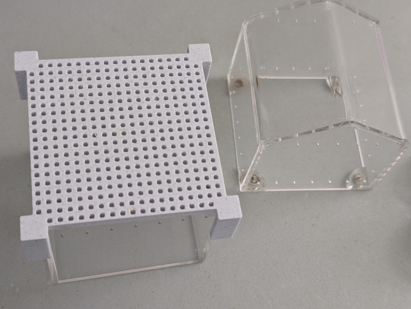

# About

A 3D-printed cover designed to fit on top of the open part of a jumping spider terrarium. This cover creates a secure barrier to ensure the spider doesn't escape while you work on or access the other terrarium section. The design features a ventilated grid pattern for airflow and corner posts for stability.

# The Model

# Design Features

The cover is designed with the following specifications:
- **77mm x 77mm** cover dimensions
- **5mm base thickness** - lightweight yet sturdy
- **Ventilated grid pattern** - 2mm square holes with 2mm walls for airflow while preventing escape
- **Corner post system** for secure placement on terrarium

## Corner Posts

The design includes corner posts for stability:
- **10mm width** - provides solid support
- **20mm height** - extends down for proper alignment
- **1mm margin** - offset outward for better fitting on terrarium edges
- Four corner posts at each corner ensure the cover stays in place

## Customization

You can modify the OpenSCAD file to adjust:
- Cover dimensions (`width`, `length`)
- Base height (`height`)
- Grid hole size (`space`)
- Grid bar thickness (`bar`)
- Corner post dimensions (`cornerWidth`, `cornerHeight`, `cornerMargin`)

# The Files

- `terrarium-cover.scad` - The OpenSCAD source file with customizable parameters
- `terrarium-cover.stl` - The exported STL model ready for 3D printing
- `terrarium-cover.3mf` - The 3MF model with slicer settings

# In Action

