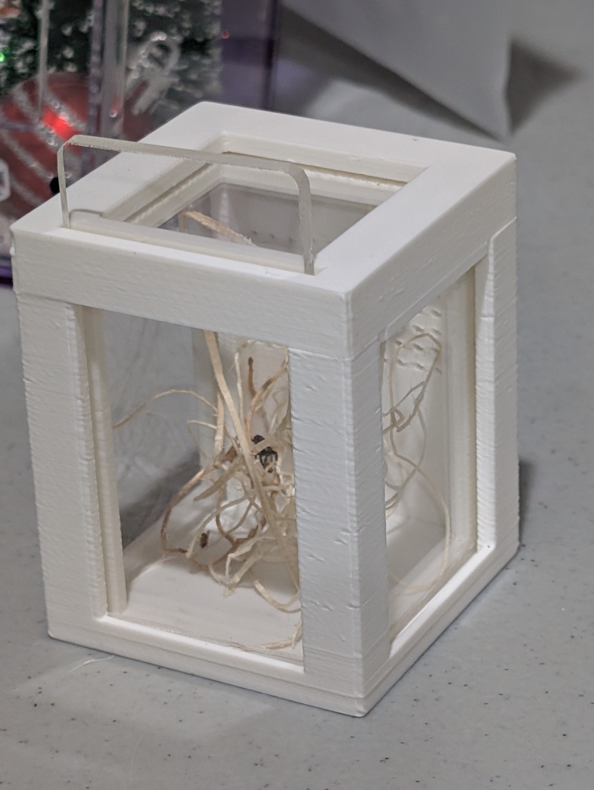

# About

A 3D-printed terrarium base and cover designed for jumping spiders. The base features corner posts with slots for sliding in acrylic or glass panels to form the walls, a ventilated back wall with a grid of holes, and small bumps along the edges to keep panels aligned. A matching cover sits on top with an open mesh frame and interlocking inserts.

# The Model

# Design Features

The terrarium is designed with the following specifications:
- **50.8mm x 50.8mm** base footprint
- **50.8mm wall height** - suitable for small jumping spiders
- **3mm solid thickness** for walls, base and cover frame
- **Panel slot system** - 3mm wide slots with 0.2mm margin in each corner post for sliding in panels
- **Ventilated back wall** - grid of 1mm holes spaced 3mm apart in the upper half for airflow
- **Bumps on edges** - small protrusions to keep panels in place

## Cover

The cover is a frame with:
- An open rectangular mesh area in the center
- Interlocking inserts that fit into the front wall corner posts
- Side bumps to align with the base panels

# The Files

- `terrarium.scad` - The OpenSCAD source file with customizable parameters
- `terrarium.stl` - The exported STL model ready for 3D printing
- `terrarium.3mf` - The 3MF model with slicer settings

# Customization

You can modify the OpenSCAD file to adjust:
- Base dimensions (`baseWidth`, `baseHeight`)
- Wall height (`wallHeight`)
- Solid thickness (`solid`)
- Panel slot width and margin (`panelWidth`, `panelMargin`)
- Ventilation hole size and spacing (`holeDiameter`, `holeSpacing`, `holeRows`)

# In Action

