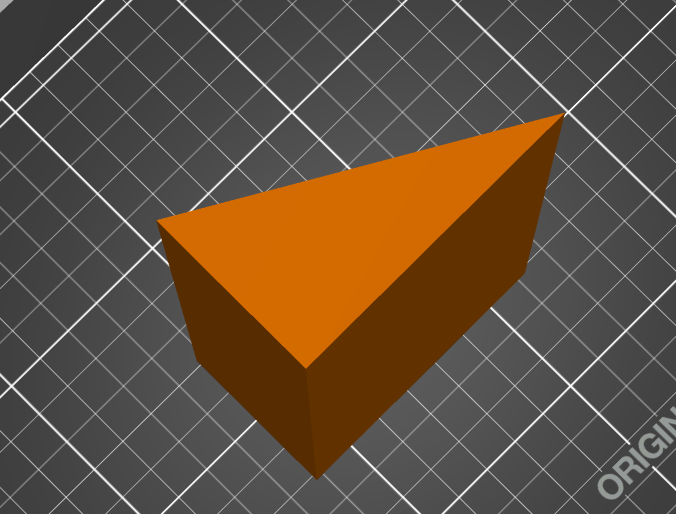
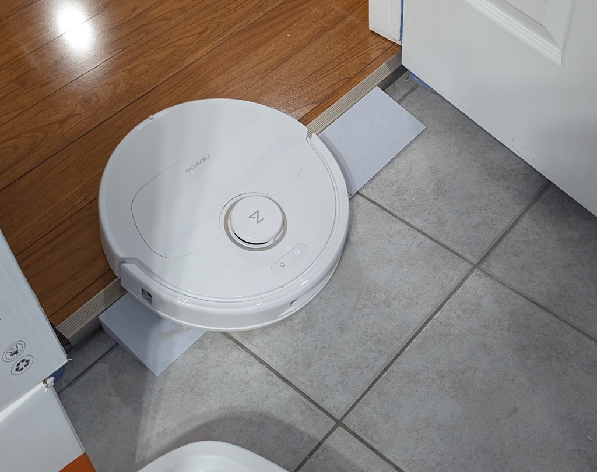

# About

A simple 3D-printed ramp designed to bridge floor gaps and level transitions. This ramp is particularly useful for helping robot vacuums move between rooms where there is a height difference or floor gap, allowing them to clean across different areas without getting stuck.

# The Model

# Design Features

The ramp is designed with the following specifications:
- **43mm height** - bridges a 4.3cm floor gap
- **15-degree angle** - gentle incline for easy traversal
- **200mm width** - put as wide as needed or the max for your printer (can print many for wider gaps)
- Simple triangular prism design for easy printing

# The Files

- `ramp.scad` - The OpenSCAD source file with customizable parameters
- `ramp.stl` - The exported STL model ready for 3D printing

# Slicer Setup

# In Use

The ramp bridges the gap between two floor surfaces, allowing robot vacuums and other wheeled devices to transition smoothly.

# Customization

You can modify the OpenSCAD file to adjust:
- Height (`HEIGHT`) - adjust to match your floor gap
- Angle (`ANGLE`) - make the ramp steeper or gentler
- Width (`WIDTH`) - adjust to your specific needs
